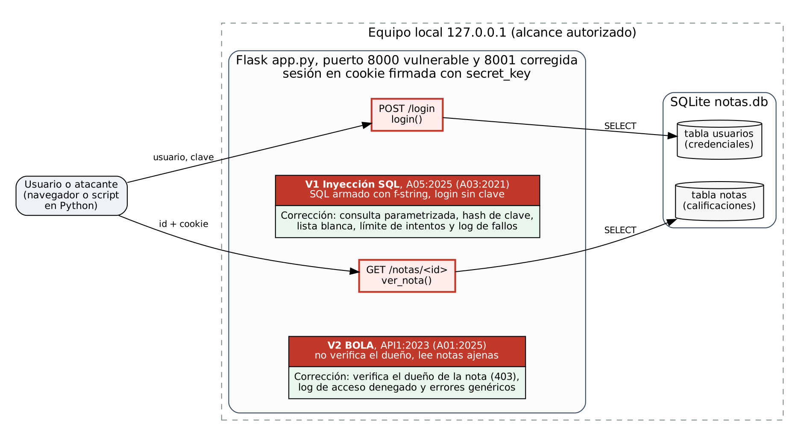

# Arquitectura y flujo de datos

## Componentes

El cliente es el navegador del estudiante o el script de pruebas, que se comunica con la aplicación por HTTP.

La aplicación Flask tiene dos rutas. `POST /login` recibe usuario y clave y crea la sesión. `GET /notas/<id>` devuelve una calificación según su número.

La sesión es una cookie firmada con `secret_key` que guarda el `usuario_id`.

La base de datos SQLite tiene dos tablas: `usuarios`, con las credenciales, y `notas`, con las calificaciones. Cada nota tiene el `usuario_id` de su dueño.

## Usuarios

El estudiante autenticado (`ana` o `luis`) puede iniciar sesión y consultar solo sus notas. El visitante sin sesión solo puede intentar iniciar sesión.

## Ubicación de las vulnerabilidades

La inyección SQL está en la función `login()` de `app.py`, en la línea donde se arma la consulta con un f-string. Afecta la tabla `usuarios`, porque permite entrar sin la clave e incluso elegir la cuenta (`luis' --`). En la versión corregida se usa una consulta parametrizada, la clave se guarda como hash, el usuario se valida con una lista blanca, hay límite de intentos y se registran los fallos.

El BOLA está en la función `ver_nota()`. Afecta la tabla `notas`, porque cualquier sesión puede leer notas ajenas cambiando el número. En la versión corregida se compara el dueño de la nota con el usuario de la sesión, se responde 403 si no coinciden y el intento queda en el log.

## Alcance autorizado

Las pruebas se ejecutaron solo en `http://127.0.0.1:8000` y `http://127.0.0.1:8001`, en nuestros equipos y en el entorno de GitHub Actions. No se probó ningún sistema externo, institucional o de terceros. Las credenciales son datos ficticios de laboratorio.
